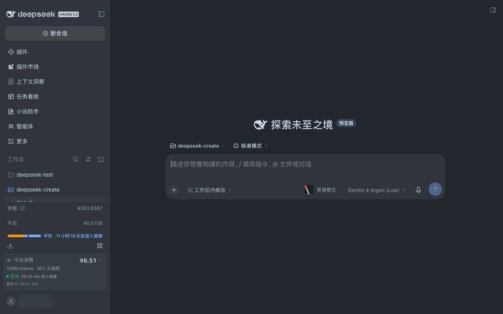
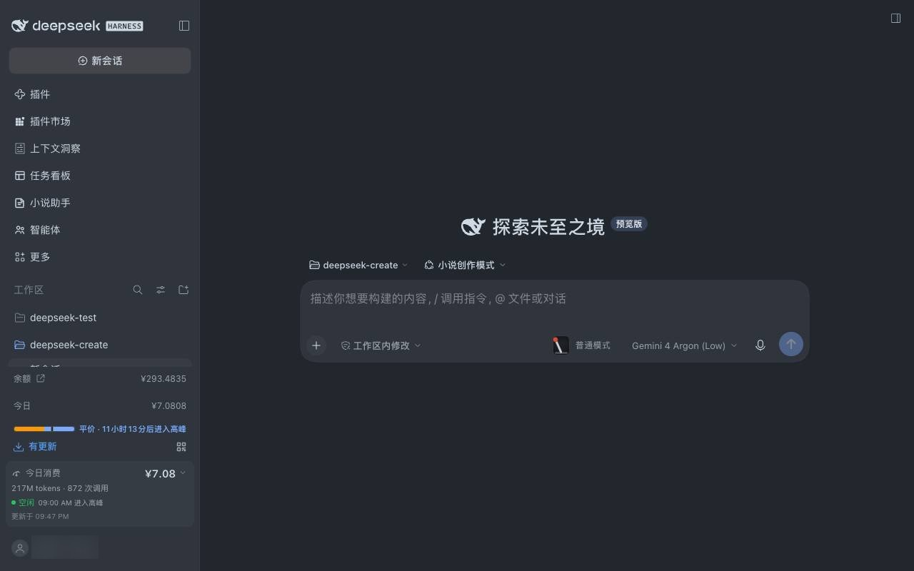
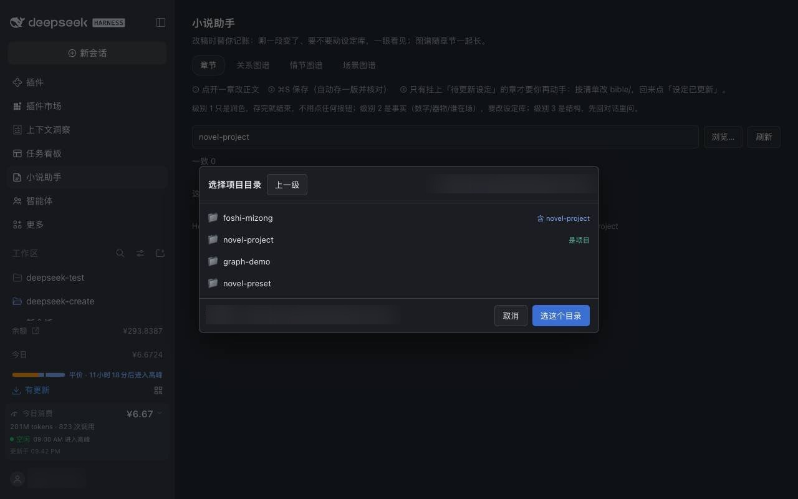
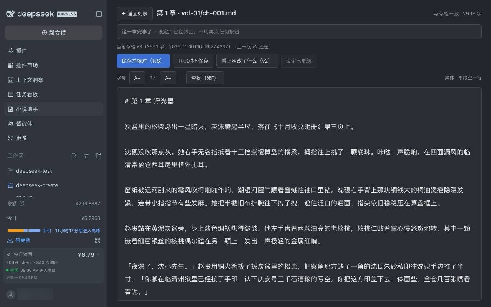
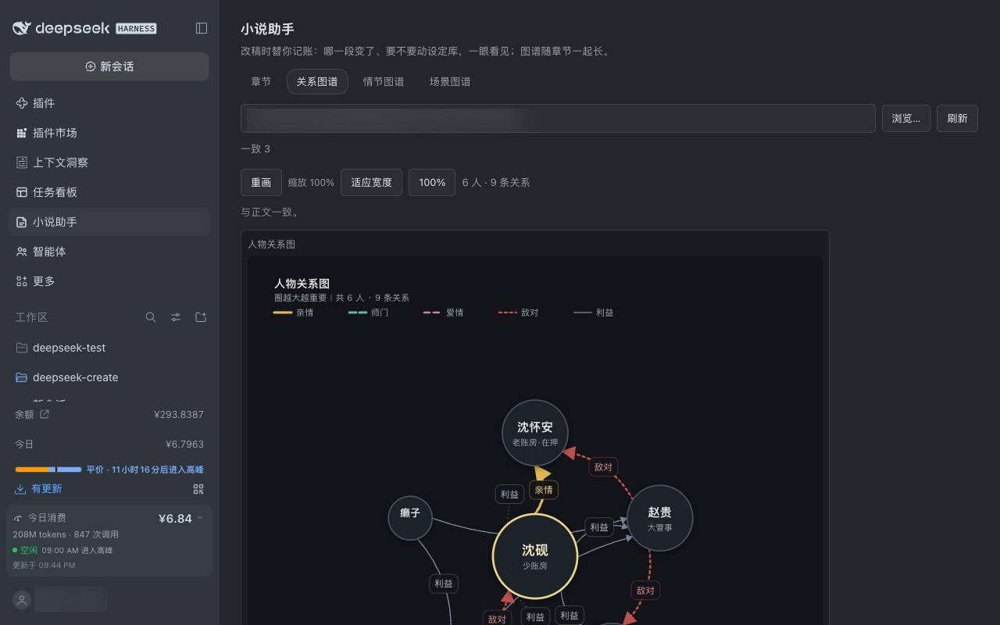
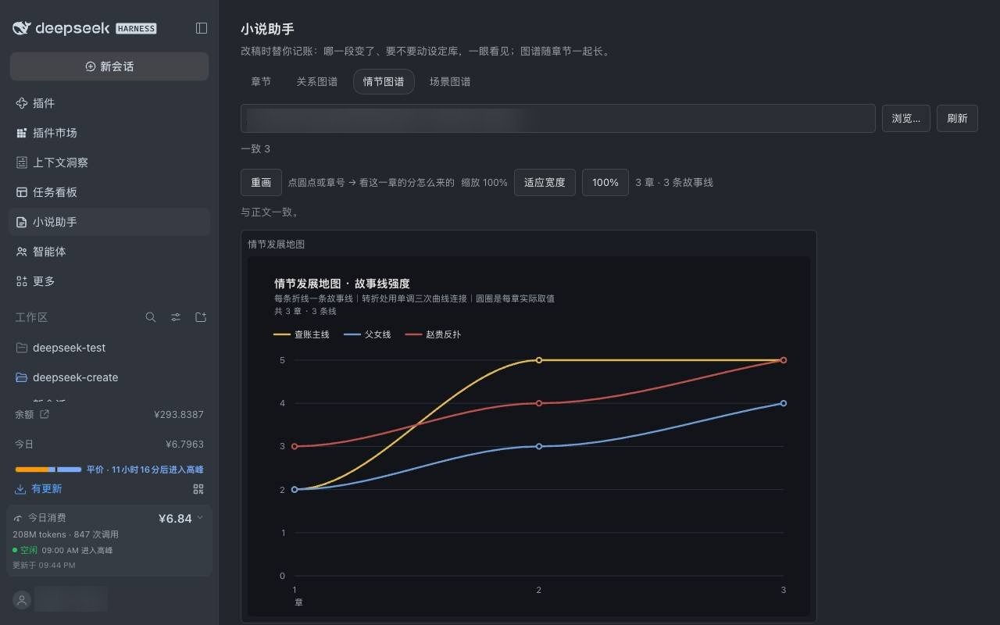
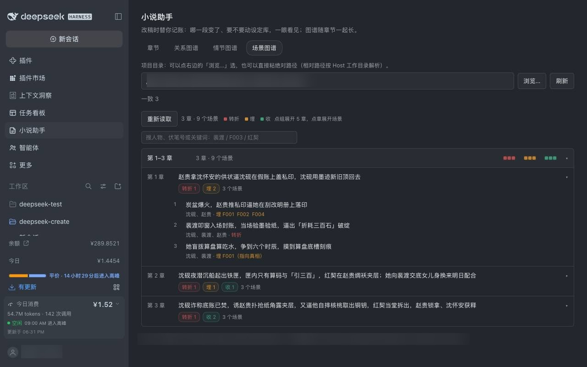

# Novel Assistant · dsh-novel-assistant

[中文](README.md) | **English**

Latest release: [Releases](https://github.com/visangela/dsh-novel-assistant/releases) · Install from npm: `dsh-novel-assistant`

What does Novel Assistant actually do? It exists for the three things that only bite you in long-form fiction: **you forget what you wrote, the book drifts from the initial settings, and editing one chapter breaks ten others.**

- **You only have a rough idea** — maybe just a title you like. It builds the framework with you through questions, and every question comes with three concrete options, so "I have no idea" is a valid answer. Bring your own idea instead and it follows your lead.
- **You already have a half-baked manuscript** — finished or not, you want the structure made explicit: who is related to whom, which threads are still open, whether the book still matches its original design. Or you want to change direction without contradicting what is already written. Import the manuscript and it rebuilds the framework, then works through the new direction with you: what it affects, how, and whether it is worth it.
- **You want to revise earlier chapters** — and you are afraid of the ripple effects. The **Chapters** panel exists for exactly this: edit any chapter, save, and it tells you which level of change you just made and what else in the setting library has to move with it. Decisions are surfaced to you, not made for you.
- **And a lot more** — including a writing agent for when you have the idea but not the sentences. Still: use what it produces as a draft to sharpen. It is an assistant, not a ghostwriter. Trusting AI blindly is worse than not using it at all.

## Installation

### Before you install

- **DSH version**: desktop or web, either is fine — the plugin loads with the Host process. The **panel** requires plugin **0.25.5+** (earlier versions registered routes through an API that DSH 0.2.1 does not have, which shows up as "Host returned an empty response"). DSH itself only needs 0.2.1+.
- **No separate Node install**: every script uses Node built-ins only, provided by DSH at runtime.
- **Permissions**: installation needs one write/authorization confirmation. Under a read-only or workspace-only policy, you will be asked once for wider access.

### Option 1 — Install from the plugin marketplace (recommended)

1. Open DSH → sidebar → **Plugin Marketplace**.
2. Search for **Novel Assistant** (the entry is labelled **小说助手**; package id `dsh-novel-assistant`) and click **Install**.
3. Accept the permission prompt. Then **restart DSH once** — the panel is a Host UI and only mounts on restart (skill text does not need a restart; it is read fresh each time).
4. After the restart, **Novel Assistant** appears in the sidebar.

### Option 2 — Install from npm

```sh
dsh plugin add dsh-novel-assistant
```

Then **restart DSH once**. Use this when you do not have the marketplace, or the marketplace has not picked up the entry yet.

### Option 3 — Install from a local directory (development / offline)

Put the plugin directory anywhere on your machine, then run this in a conversation:

```text
plugin_manager action=install_bundle target=<absolute path to the plugin directory>
```

For example `target=/Users/you/code/novel-preset`. Installation loads `lib/skill-provider.js` inside the Host process and needs the same authorization. **Restart DSH once** afterwards.

**Verify the install** (any one of these):

- **Novel Assistant** shows up in the sidebar;
- **小说创作模式** (Novel Writing mode) appears in the mode list of a new session;
- `plugin_manager action=list_bundles` lists this bundle.

### Updating

| Installed via | How to update |
| --- | --- |
| Marketplace | **Plugins** page → **Refresh**; an update entry appears on the card. Restart DSH after updating. |
| Local directory | Pull the new code or replace the directory contents (`link` installs need no reinstall). **Restart DSH** so the panel half reloads. |
| Skill text only | Edit `skills/*/SKILL.md` directly — it takes effect on the next conversation, no restart, no reinstall. |

> Updating never touches your project files. Manuscripts, the setting library, maps and chapter archives all live in your workspace under `novel-project/`, separate from the plugin directory.

### Uninstalling

```text
plugin_manager action=remove_bundle target=<bundle name or directory>
```

Then **restart DSH once**; the sidebar entry and the mode entry disappear.

**Uninstalling does not delete your novel**: `novel-project/` (including `chapters/`, `bible/`, `reviews/`, `chapters/.versions/`) stays in your workspace, ready to continue after a reinstall.

## Workflow

| Stage | Skill | Output |
| --- | --- | --- |
| −1 Import | `novel-import` | manuscript health report, normalized chapters and archives, rebuilt ledgers |
| 0 Setup | `novel-setup` | project directory, `PROJECT.md`, setting-library skeleton |
| 1 Architecture | `novel-architecture` | world, premise hook, relationships, character sheets |
| 2 Style | `novel-style` | style guide plus a ~300-character sample |
| 3 Outline | `novel-outline` | main line, ending, volumes, per-chapter key beats |
| 4 Outline review | `novel-outline-review` | multi-role review report and fixes |
| 5 Setting library | `novel-bible` | timeline, foreshadowing ledger, character index, reader/protagonist knowledge, hard facts, chapter digests |
| 6 Detailed outline | `novel-detailed-outline` | 3–5 chapters per batch |
| 7 Draft | `novel-draft` | chapter prose |
| 8 Quick check | `novel-quick-check` | logic / character / foreshadowing / pacing check every 1–3 chapters, with linked fixes |
| 9 Volume review | `novel-mid-check` | five reviewers, volume verdict and hand-off to the next volume |
| 10 Final check | `novel-final-check` | AI-tell, logic-bug and reading-experience fix list |
| 3 → 11 | `novel-graph` | relationship map and plot map (`.md` tables + generated `.svg`; first draft at stage 3, grows with the manuscript) |

`novel-workflow` is the controller: it detects the current stage, routes to a skill, and enforces the confirmation gates.

## How to use — starting a new novel

### 1. The sidebar gains a "Novel Assistant" entry

After installing and restarting, **Novel Assistant** appears in the left sidebar. It handles the *after* writing work: revision reconciliation, relationship and plot maps. The writing itself happens in the conversation.



### 2. Start a new session and pick the mode

Click **New session**, then choose **小说创作模式** (Novel Writing mode) in the mode selector under the input box. After that, just say what you want to write — a sentence, a title, or a single image is enough. If you have nothing yet, say "start a novel" and it will ask with three options.



### 3. Pick the project directory in the panel

On first open, the path field shows `novel-project`, resolved against the Host working directory. Click **Browse…** and walk the tree to your project root — the row marked `是项目` ("is a project") is an existing novel project, `含 novel-project` means the project sits one level down. The choice is remembered.



### 4. Revise in the "Chapters" tab

Open any chapter and edit the prose in place; `⌘S` saves and reconciles — it archives a version and tells you which *level* of change this was and whether the setting library has to move. Level 1 is polish: save and you are done. Level 2/3 attaches a "settings pending" badge to the chapter; clear it once the library is updated.



### 5. Three maps

**Relationship map** sizes each circle by importance and distinguishes kin / mentor / romance / hostile / transactional relationships. Hover a relation card to read the tension note; hover a person to isolate their relations; click a person to jump to their first chapter.



**Plot map** plots storyline intensity per chapter. Click a point or a chapter number to see why that chapter scored what it did, with the digest and outline lines it came from.



**Scene map** shows one row per chapter, five chapters per group: see where the turns, plants and payoffs cluster, then expand a chapter for its scene cards — no endless scrolling at chapter 40.



All three are generated from the text tables in `bible/` — edit a table, hit **Redraw**, and the picture follows; the panel names any chapter where the map and the table disagree.

## How to use — importing a manuscript in progress

Already written part of it and want to continue with this workflow? You do not build directories by hand and you do not move files around — **the whole import happens in conversation**; you only need the manuscript and its path.

### 1. Put the manuscript in a shape the plugin understands

It reads `.md` only. **One file per chapter** is easiest. If you are in Word or txt, save as `.md` first — the filename just needs a chapter number (`第1章 浮光墨.md`, `ch-001.md`, `1.md` all work); the first line should ideally be `# 第 1 章 …`.

One big file is fine too: it can be split by "chapter N" for you — hand it over and check the result.

Any folder works, e.g. `~/Documents/my-novel/`. You do **not** need to create `novel-project/` yourself.

### 2. Confirm the plugin is installed

Restart DSH once; **Novel Assistant** in the sidebar means it is ready (the panel half only loads on restart).

### 3. Start a new session and pick the mode

Pick **小说创作模式** (Novel Writing mode). Without it the assistant just answers like a general-purpose chat.

### 4. Say what you want in one sentence

> I'm writing a novel in `/Users/you/Documents/my-novel/` — 23 chapters, about 150k characters so far, and I want to continue.

A more careful version asks first, without touching anything:

> Don't modify my files yet — just tell me whether this manuscript can be brought into your workflow.

It scans the directory and reports how many chapters and characters it found, whether chapter numbers repeat or skip, which ledgers are missing, and whether this is a "has an outline" or "prose only" case.

### 5. Read the plan before it touches files

It will not rewrite your manuscript. First it prints a **plan table**: which files become `chapters/vol-01/ch-001.md`, which are skipped. Only after you approve does it —

- copy the originals into `chapters/_original/` as a backup;
- copy the prose **verbatim**, adding only a missing heading line;
- create a v1 archive per chapter, so later revisions can be reviewed.

If chapter numbers repeat or skip, it stops and asks instead of guessing. At that point the manuscript is part of the project; rebuilding the ledgers and the health check continue in conversation, and you can stop at any time.

## Writing with your own model — yes, that works

By default the prose is written by **whatever model the current session runs on** — no configuration needed. To use a different model for drafting, three steps:

1. **Install the matching subscription or provider on the Host** so DSH can see it (e.g. Google Antigravity, or any OpenAI-compatible endpoint).
2. **Enable that route under Plugins → Subagents → Model selection.** This is a Host switch: if the route is not enabled, the plugin cannot dispatch to it and falls back to the default model.
3. **Start a new session.** The policy is snapshotted when a session is created, so existing sessions do not pick it up.

Once configured, **before chapter 1 it writes two short samples with two different models** (an opening hook and a mid-scene advance), then reports length, average paragraph size, dialogue ratio, and three differences you can point at in the text. You pick the writer from real pages, not from a description.

Staying on the default model is perfectly fine: skip all three steps and the workflow is unchanged — setting library, validation and revision reconciliation all still apply.
