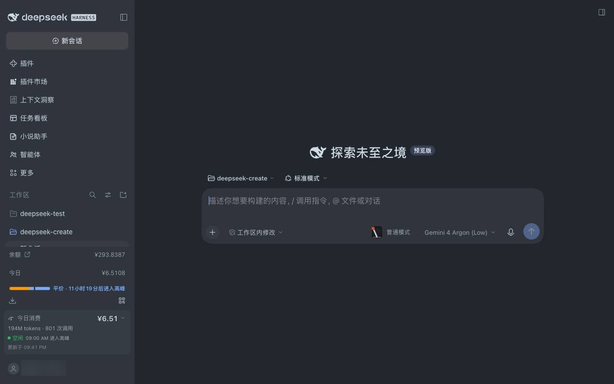
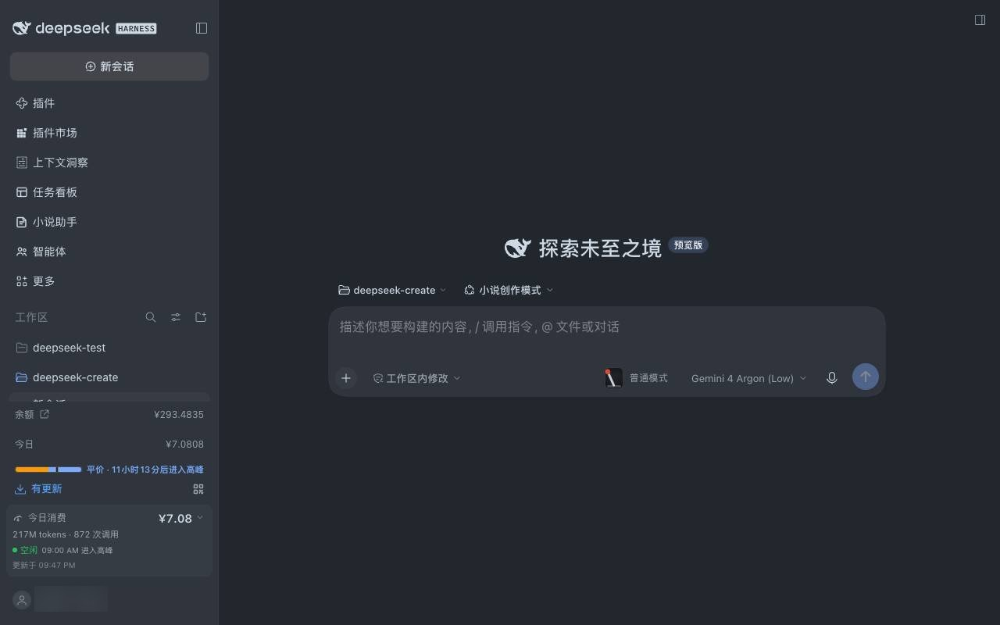
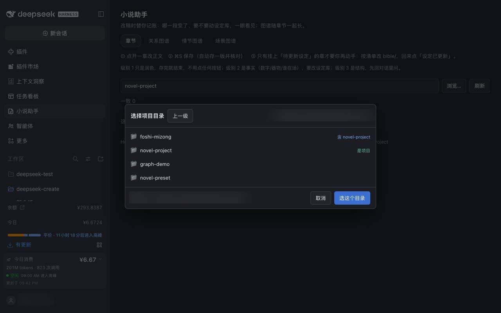
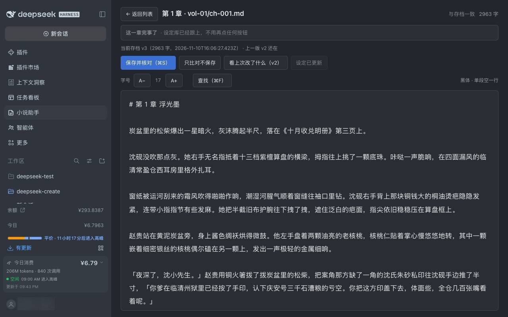
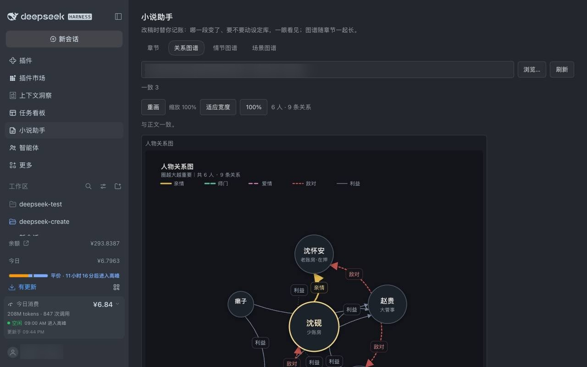
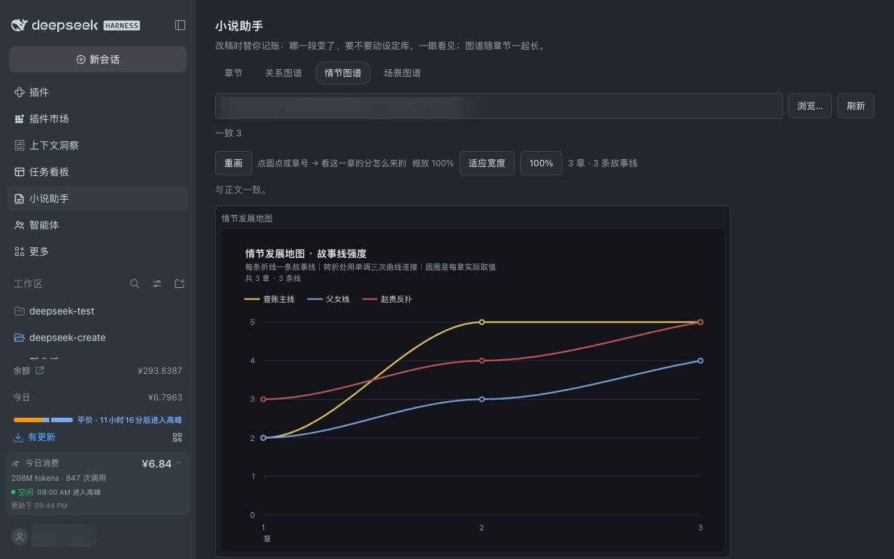
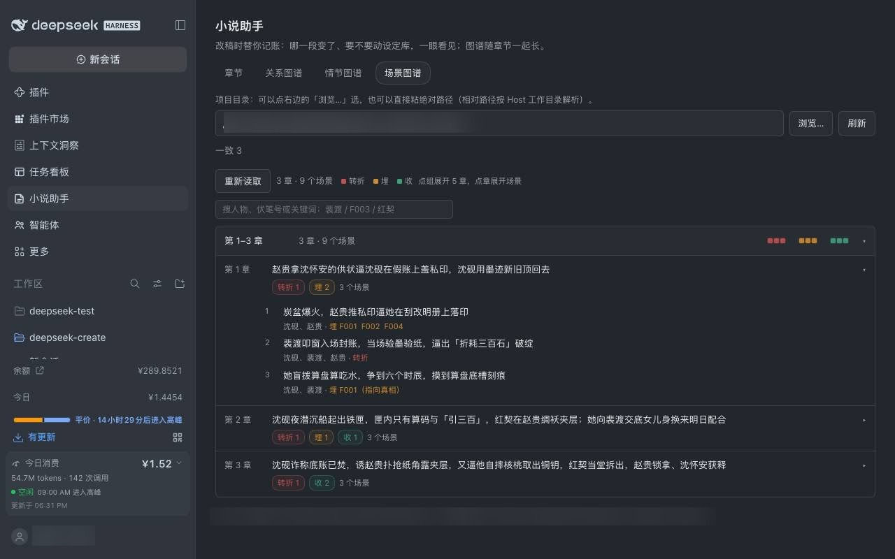

# 小说助手 · dsh-novel-assistant

最新版本见 [Releases](https://github.com/visangela/dsh-novel-assistant/releases)，也可以直接装 [npm 上的同名包](https://www.npmjs.com/package/dsh-novel-assistant)。

小说助手这个工具能做什么？简单来说，它解决的是长篇特有的三件事：记不住、写飘了、改乱了。 如果你：

1. 只有一个简单想法，简单到只想到一个有趣的标题。它能帮你通过问答的形式逐步帮你搭建一个完整的长篇小说框架，没想法也不用怕，每次提问它都准备了三个备选的选项，当然你也可以告诉它你的脑洞，别的都交给它；
2. 手里已经有一部完成/半完成的小说稿，但是因为种种原因你需要一个助手帮你理清思路，整理出小说现有的框架，看看里面的所有关系，伏笔等是不是符合最初的设定。或者你单纯想到一个更好的方向希望接下来换个思路写，但是又怕之后写的内容和前面的内容冲突写蹦，别怕，只要导入你的小说到小说助手里面，它就能快速帮你理清已有的小说框架，你再把新的想法告诉它，它能陪着你分分钟判断新的方向如何展开更好，会不会影响之前的内容，会怎么样影响，要不要改？总之一句话，小说助手的唯一目的就是帮你更好、更快得进入小说创作中。
3. 写着写着想要返回前面的内容修改某些部分，又怕牵一发而动全身，不知道小说别的章节会不会被影响，以及哪些部分被影响了，该怎么办？小说助手面板中有专门的”章节“页面就是为改稿而生，你可以放心进行任意章节的内容修改，修改后会引发的连锁影响将由小说助手接管帮你去梳理，遇到需要决策的事情会主动通知你。
4. 还有很多很多……当然，小说助手也配备了专业的写作agent帮你解决只有想法却写不出来的困境。但是，即使如此，依旧希望你能够在助手生成的内容基础上去优化和打磨。毕竟它只是个助手，不是写手本手。尽信 AI 不如没有 AI。

## 如何安装

### 安装前确认

- **DSH 版本**：桌面版或 Web 版都可以，插件随 Host 进程加载。
- **不需要另装 Node**：所有脚本只用 Node 内置模块，运行时由 DSH 提供。
- **权限**：安装需要一次文件写入与加载确认；如果当前是「只读」或「工作区内修改」权限，安装时会向你申请一次更宽的授权。

### 方式一：从插件市场安装（推荐）

1. 打开 DSH → 侧栏 **插件市场**。
2. 搜索 **小说助手**（英文标识 `dsh-novel-assistant`），点 **安装**。
3. 出现权限确认时选允许；安装完成后 **重启一次 DSH**——面板是 Host 的界面，只有重启才会挂到侧栏上（技能正文不用重启，每次读取）。
4. 重启后在侧栏看到 **小说助手**，即安装成功。

### 方式二：从 npm 安装（命令行）

已发布到 npm registry，开箱即用：

```sh
dsh plugin add dsh-novel-assistant
```

装完 **重启一次 DSH**。没装插件市场、或市场里还没搜到新条目时，走这条。

### 方式三：从本地目录安装（开发或离线）

把插件目录放在本机任意位置，然后在对话里执行：

```text
plugin_manager action=install_bundle target=<插件目录的绝对路径>
```

例如 `target=/Users/you/code/novel-preset`。安装会在 Host 进程加载 `lib/skill-provider.js`，同样需要一次授权；装完 **重启一次 DSH**。

**验证是否装好**（任选其一）：

- 侧栏出现 **小说助手**；
- 新会话的模式列表里出现 **小说创作模式**；
- 对话里执行 `plugin_manager action=list_bundles`，能在列表里看到这个 bundle。

### 更新

| 安装方式 | 怎么更新 |
| --- | --- |
| 插件市场 | 打开 **插件** 页 → 点 **刷新**，有新版本时条目上会出现更新入口；更新后重启 DSH |
| 本地目录 | 拉取新代码或替换目录内容（本地 `link` 安装无需重装）；**重启 DSH** 让面板半侧生效 |
| 只想改技能文案 | 直接改 `skills/*/SKILL.md` 即可，下次对话就生效，不用重启、不用重装 |

> 升级不会动你的项目文件。`novel-project/` 里的正文、设定库、图谱、存档都在工作区里，和插件目录是分开的。

### 卸载

```text
plugin_manager action=remove_bundle target=<bundle 包名或目录>
```

卸载后 **重启一次 DSH**，侧栏入口与模式列表里的条目会消失。

**卸载不会删你的小说**：`novel-project/`（含 `chapters/`、`bible/`、`reviews/`、`chapters/.versions/`）留在工作区，随时可以重新安装后继续写。

## 工作流

| 阶段 | 技能 | 产出 |
| --- | --- | --- |
| −1 导入 | `novel-import` | 稿件体检报告、归一后的章节与存档、重建的账本 |
| 0 立项 | `novel-setup` | 项目目录、`PROJECT.md`、设定库骨架 |
| 1 架构 | `novel-architecture` | 世界观、金手指、情感关系、人物小传 |
| 2 风格 | `novel-style` | 风格指导书 + 300 字样段 |
| 3 大纲 | `novel-outline` | 主线、结局、分卷、章节关键设定 |
| 4 审核 | `novel-outline-review` | 多角色评审报告与修法 |
| 5 设定库 | `novel-bible` | 时间线、伏笔账本、人物库、读者/主角信息表、硬事实、章节摘要 |
| 6 细纲 | `novel-detailed-outline` | 每批 3–5 章的细纲 |
| 7 正文 | `novel-draft` | 章节正文 |
| 8 快检 | `novel-quick-check` | 1–3 章一次的逻辑/人物/伏笔/节奏检查与联动修改 |
| 9 卷末会审 | `novel-mid-check` | 五个角色开会，卷结论与下一卷衔接 |
| 10 完稿检查 | `novel-final-check` | AI 味、逻辑 bug、阅读体验修复清单 |
| 3 起 / 11 定稿 | `novel-graph` | 人物关系图、情节发展地图（`.md` 表 + 自动生成的 `.svg`；阶段 3 出初版，之后随章节生长） |

总控 `novel-workflow` 负责判断阶段、路由技能、执行门禁。

## 如何使用——新开小说

### 1. 侧栏会多一个「小说助手」

安装并重启之后，DSH 左侧栏出现 **小说助手**。它管的是「写完之后」的事：改稿核对、看关系与情节。真正的创作在对话里进行。



### 2. 新建会话，在模式里选「小说创作模式」

点左上 **新会话**，在输入框下方的模式选择里选 **小说创作模式**。选好之后，直接说你想写什么就行——一句话、一个标题、一个画面都够；没有想法就说「开始写小说」，它会用三个备选选项问你。



### 3. 面板选项目目录

第一次打开面板，路径框里是默认值 `novel-project`（按 Host 工作目录解析）。点 **浏览…** 从目录树里挑项目根目录——带 `是项目` 的那一行就是已经建好的小说项目，`含 novel-project` 表示下一层里有项目；选完自动记住，下次直接打开。



### 4. 改稿就在「章节」页

点开任意一章，正文直接在面板里改；`⌘S` 保存并核对，自动存一版并告诉你「这次属于哪一级改动、要不要动设定库」。级别 1 只是润色，存完就结束；级别 2/3 会在这一章挂上「设定待更新」，等设定库跟上了再点「设定已更新」。



### 5. 关系、情节、场景三张图

**关系图谱**按人物档位画圈（越大越重要），线型区分亲情/师门/爱情/敌对/利益；鼠标停在标签上看张力说明，悬停在人物身上只留他的关系，点人物会跳到首次出场的那一章。



**情节图谱**是故事线强度曲线，点圆点或章号能看「这一章为什么给这个分、依据是摘要与细纲的哪几条」。



**场景图谱**把一章拆成几个场景，标出转折、埋点与回收点，改稿时一眼看出哪一段动了。



三张图都由 `bible/` 里的文字表生成——表改了，点「重画」就同步；图与表不一致时面板会直接点名。

## 如何使用——导入已有作品

已经写了一部分、想接着用这套流程？不用自己先建目录、也不用把稿子搬来搬去——**导入全程在对话里完成**，你只要准备好稿子、说清它在哪。

### 1. 先把稿子摆成插件认得的形状

插件只认 `.md` 文件，**一章一个文件**最省事。现在还是 Word 或 txt 的话，先另存为 `.md`——文件名带章号就行（`第1章 浮光墨.md`、`ch-001.md`、`1.md` 都认），正文第一行建议写 `# 第 1 章 浮光墨`。

只有一整份大文件也不用怕：按「第 N 章」拆成多个文件即可；这一步也可以直接交给它做，把整份给它，拆完你过一眼。

放哪个文件夹都行，比如 `~/Documents/我的小说/`。**不需要**自己建 `novel-project/`。

### 2. 确认插件在

装好后重启一次 DSH，侧栏出现 **小说助手** 就说明装好了（面板半侧要重启才加载）。

### 3. 新建会话，选「小说创作模式」

点左上 **新会话**，在输入框下方的模式里选 **小说创作模式**。这一步决定它走哪套流程；不选的话，它只会当普通助手回答你。

### 4. 一句话说清来意

> 我写了一部小说，在 `/Users/你/Documents/我的小说/`，已经写了 23 章大概 15 万字，想接着往下写。

更谨慎的版本是先探路、不动文件：

> 先别动我的文件，帮我看看这套稿子能不能接进你的流程。

它会扫一遍目录，告诉你认出多少章、多少字、章号有没有重复或断号、缺哪几本账本，并判断属于「已有大纲」还是「只有正文」两种情形之一。

### 5. 先看计划表，再让它动文件

它不会直接改你的稿子。第一步只给一张**计划表**：哪些文件会改名成 `chapters/vol-01/ch-001.md`、哪些跳过；你点头之后才执行——

- 原稿**复制**一份到 `chapters/_original/` 留底；
- 正文**一个字不改**，只补缺失的标题行；
- 每章建一份 v1 存档，之后改稿能随时回看。

章号重复或断号时它会停下来问你，不会替你猜。到这一步你的稿子就已经接进项目了，后面重建账本与体检都在对话里继续，随时可以叫停。
