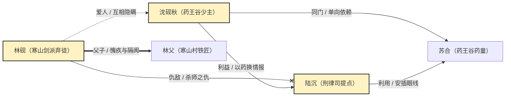
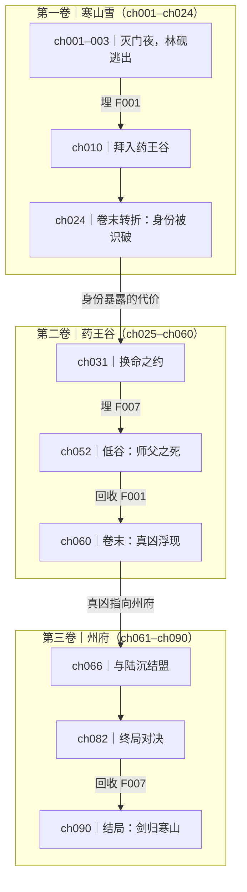

# 人物关系图与情节地图（阶段 3 起持续更新，阶段 11 定稿复核）

目标：把几十万字压成两张能一眼看懂、还能被引用的图。**图是索引，不是正文摘要**；图里放不下的细节留给文字表。

## 零、图是活的（先读这节）

这两张图不是定稿后才画的交付物，**从大纲出来就要有初版，之后跟着正文长**。四个时点：

| 时点 | 做什么 | 命令 |
| --- | --- | --- |
| 阶段 3 大纲完成 | 出 v0：人物与关系从人物小传抽，情节图先只有章节骨架 | `graph-sync.mjs --init` → `render-graph.mjs` |
| 阶段 6 每批细纲 | 给本批章节的「故事线强度」填规划值 | 手填行 → `render-graph.mjs` |
| 阶段 7 每章落盘 | 该章强度改成实测值；新人物、新关系自动进表 | `graph-sync.mjs` → `render-graph.mjs` |
| 修稿之后 | 级别 2 挂「图谱待复核」；级别 3 先列失效章再重算 | `graph-sync.mjs --check` 先看差多少 |

两条命令分工固定，不要混：

- **`graph-sync.mjs` 管「表该有什么」**：从 `characters/_index.md`、每份小传的「## 关系网」表、`outline.md`、`foreshadowing.md`、已写章节数，把缺的人物、缺的关系、缺的章节行补进两张 `.md`。
- **`render-graph.mjs` 管「把表画出来」**：只读表，不猜、不补。

**sync 只补缺，不覆盖**：人改过的张力措辞、打过的强度分，脚本一律不动。所以可以放心在每章落盘后随手跑一次。

判断留给人（agent）：谁算重要配角、这一章这条线几分、张力怎么写。机器算的只是「有没有这一行、这一章缺不缺」。

Web GUI 的「小说助手」面板有两页图谱（「关系图谱」「情节图谱」），能分别放大看、并按「重画」重跑脚本；它和命令行调的是同一份实现。阶段 8 还会跑 `plot-check.mjs` 查曲线的三种形状（平线 / 掉速 / 断钩）。

图谱页的只读溯源：情节图下方点章号，返回这一章各线分数、`digest.md` 那行摘要、以及细纲各节要点。它只回答「这个分凭什么」，不提供编辑——分数由 agent 在阶段 6/7 打，改分数请回对话里说，顺手重跑 `plot-check`。

## 一、触发与范围

- 主动触发：阶段 10 定稿门禁通过后，出两张图作为交付物。
- 被动触发：用户随时说「画个人物关系图」「看看主线怎么走的」「做张情节地图」，或准备宣传物料、续作规划。
- 图只画到「用户确认的范围」；剧透口径先定，别默认把结局写进节点。

范围用 `ask_user_question` 一次问完（最多 3 问）：

1. **「关系图要画哪些人？」** 选项：主要人物 8–15 人（推荐，图才看得清）/ 所有有名字的角色（可能 30+，会分成主图 + 附表）/ 我指定几个人。
2. **「要不要标注剧透？」** 选项：不标（推荐，可对外分享，身份用「身份不明」）/ 标注真相与结局（自己复盘用）/ 分两版各出一份。
3. **「情节图画到什么粒度？」** 选项：按卷 + 关键转折（推荐，10–15 个节点）/ 按章（只适合 30 章以内）/ 只画主线三幕。

拿到答案再读文件，不要先画后问。

## 二、读什么

| 文件 | 取什么 |
| --- | --- |
| `bible/characters/_index.md` | 姓名、身份、阵营、与主角关系、首次出场、当前状态 |
| `bible/characters/*.md` | 关系细节、执念、关系变化的关键事件 |
| `bible/outline.md` | 分卷表、章节关键设定、主线问题与结局、节奏曲线 |
| `bible/foreshadowing.md` | 伏笔编号、埋设章、回收章、状态 |
| `bible/timeline.md` | 关键事件的故事时间（情节图要对得上） |
| `PROJECT.md` | 卷数、章号范围、定稿状态 |

人物不足 5 个或关系只有「主角—反派」一条线时，先用 `grep` 从正文里补关系证据（谁救过谁、谁背叛过谁），再画；不要凭空造关系。

## 三、`bible/relationship-map.md`

### 文件结构

依次写：标题 → 引用块（范围 / 含剧透 / 生成日期，加一句「渲染失败看文字表，配图见同目录 `relationship-map.svg`」）→「线型约定」表 →「人物档位」表 →「关系图」Mermaid 代码块 →「文字版关系表」。

线型约定固定五行，照抄即可：

| 线型 | 含义 |
| --- | --- |
| 粗实线 `==>` | 亲情（血缘、养育） |
| 虚线带圈 `--o` | 师门（师徒、授业、传人、门生） |
| 虚线 `-.->` | 爱情（含单恋、旧情、联姻中的真情） |
| 带叉 `--x` | 敌对（仇恨、对立阵营、背叛） |
| 细实线 `-->` | 利益（合作、利用、交易、上下级） |

**师门单列的理由**：师徒在中文里常被写成「恩师 / 徒弟 / 门生」，它与血缘是两套伦理，混在一起会看不出「谁把谁教出来的」。

文字版关系表字段：人物 A、人物 B、关系、张力、关键事件（章）。

### Mermaid 示例



### 画法约定

- 节点文本统一写「姓名（身份）」，身份用最能让读者定位的那个（门派、职位、与主角的关系），不要写「主角」两个字当身份。
- 边标签用「关系 / 张力」两段式：「师徒 / 互相利用」「夫妻 / 各有秘密」。**只写关系不写张力，图就没有信息量。**
- 方向表示主动方：谁先伸手、谁在利用谁，箭头从主动方指向被动方；互相利用就画两条或一条双向边，不硬凑。
- 主角用 `classDef` 高亮；反派、爱人、引路人可用第二种高亮，最多两种，再多就花。
- 只画主要人物（默认 8–15 人）。超过 20 人时分主图 + 「次要人物附表」，不要把图塞满。
- `--x` 带标签的写法若在你的渲染器里失败，去掉该边标签，把「敌对 / 原因」写进文字表；不要为了一个标签牺牲整张图。

### 文字表兜底

图后必须有一张表，字段：人物 A、人物 B、关系、张力、关键事件（章）。表里可以放图里省略的次要关系，但主图与表的主要关系必须一致；不一致时以表为准并修图。

## 四、`bible/plot-map.md`

### 文件结构

依次写：标题 → 引用块（范围 / 含剧透 / 生成日期）→「主线一句话」→「情节图（按卷）」Mermaid 代码块 →「卷—事件—人物变化表」→「故事线强度（每章 0–5）」表 →「伏笔埋收对照」→「主线问题与回收」。

### Mermaid 示例



### 画法约定

- 一个 `subgraph` 一卷，标题写「卷名（章号范围）」；卷内只放 3–5 个节点：卷首事件、中点、卷末高潮。
- 节点文本统一「章号｜事件」，事件写到「谁做了什么、结果如何」，不写「冲突升级」这种抽象词。
- 转折点、低谷、终局这三个节点用不同 `classDef` 标出来，读者一眼能找到节奏位置。
- 伏笔用边标签标「埋 F00X」「回收 F00X」，编号必须与 `foreshadowing.md` 一致；未回收的伏笔画虚线到「结局」节点并标「未回收」。
- 全书超过 4 卷或节点超过 25 个时，拆成「主线图 + 分卷图」，不要一张图装完。

### 卷—事件—人物变化表

| 卷 | 章号范围 | 核心事件 | 主角变化（起点→终点） | 冲突升级 | 卷末钩子 |
| --- | --- | --- | --- | --- | --- |
| 一 | ch001–ch024 | 灭门、入谷 | 幸存者 → 有牵挂的人 | 个人恩怨 | 身份被识破 |

另加两节：

- **伏笔埋收对照**：编号、埋设章、回收章、状态，直接从 `foreshadowing.md` 摘要，只列主线的 8–15 条。
- **主线问题与回收**：抄 `outline.md` 的「全书要回答的问题」，逐条写在哪一章被回答、回答得够不够。

## 五、生成配图（SVG）

文字表是数据源，配图由脚本从表里画，**不要手画、不要贴图床**。同一份表改完重跑即可，图永远和表一致。

```bash
# 1) 先把设定库里的事实补进表（缺的才补，已有的不动）
node <技能 Base directory>/tools/graph-sync.mjs --project novel-project
# 2) 再从表画图
node <技能 Base directory>/tools/render-graph.mjs --project novel-project
```

`graph-sync` 的退出码：0 全同步；1 有告警（已写章节缺强度分、人物缺小传、表缺列）；2 读不到设定库。`--check` 只检查不写盘，`--init` 在两张 `.md` 不存在时生成初版骨架（阶段 3 用）。

产出 `bible/relationship-map.svg`、`bible/plot-map.svg`（矢量，浏览器/预览直接打开，插进 Markdown 也会显示）。加 `--check` 只校验不写盘，`--json` 出机器可读结果。

### 关系图的两种布局（自动选，可强制）

| 人数 | 布局 | 长什么样 |
| --- | --- | --- |
| ≤ 8 人 | **环形**（主角居中） | 主角在圆心，其余按档位排内外两圈；适合人少、要看清「谁围着主角」 |
| ≥ 9 人 | **簇状**（多中心） | 选 2–6 个簇心（主角必选，其余按连接数），每人挂到连线最多的簇心，成员绕簇心排一圈；簇心再排成一圈，跨簇的连线画出来 |

强制切换：`--layout=ring` 或 `--layout=cluster`（默认 `auto`，即上表）。

**簇状布局的三条约定**：

1. **不画簇的光晕**。光晕在 4 个簇以上必然相切，反而增加噪声；「谁和谁一伙」靠距离与连线密度读出来。
2. **跨簇的连线压到 38% 透明度、不放文字标签**。标签会把 17 人的图埋掉；要看某条关系的具体说法，看本文文字表，或在面板里悬停（有 tooltip）。
3. **一个簇心若一个成员都没分到，会被降级成相邻簇的成员**，不留空圈。

### 关系图怎么读表

- **「文字版关系表」是唯一数据源**：人物 A、人物 B、关系、张力（、类型）。
- **「人物档位」表由 `graph-sync` 自动生成**（主角按 `_index.md` 的「与主角关系」认，其余按关系条数：≥2 条算重要配角、1 条算次要），你不用手填；但**它只是初值**，剧情需要时（比如某个次要角色其实是暗线核心）直接改这一格，sync 不会覆盖已有行。

| 人物 | 档位 | 身份 |
| --- | --- | --- |
| 沈砚 | 主角 | 少账房 |
| 裴渡 | 重要配角 | 查账佥事 |

档位三种：主角 / 重要配角 / 次要。圈按 54 / 42 / 28 三档画，次要人物进外圈且不写身份。

- 「类型」列可选（亲情 / 爱情 / 敌对 / 利益），不写就按「关系」里的词猜（父女→亲情、夫妻→爱情、死敌→敌对，其余算利益）。**猜错的代价是线型不对**，关系词写得含糊时请补这一列。

### 情节图怎么读表

折线图只认「故事线强度」表：第一列表头必须写「章」，每列一条故事线，单元格是 0–5 的整数。

| 章 | 查账主线 | 父女线 | 赵贵反扑 |
| --- | --- | --- | --- |
| 1 | 2 | 1 | 1 |

打分口径写死在文件里（0 = 本章这条线没动，3 = 推进且有代价，5 = 本章高潮或无路可退的转折），**已写章节填实测值，未写的填规划值并在表下注明「第 N 章起为规划」**。这张表是主观判断，不是从正文算出来的，别把它当客观指标引用。

### 图上做对了的几件事（改脚本时别退化）

- **主角在圆心**，其余人按圈排；只有一个主角时这么摆，交叉最少。
- **边是弧线**，两人之间多条关系不会重叠；弧的弯度随边长收敛，短线不会甩出圈外。
- **标签自动避让**：沿弧线找空位，实在避不开就偏出去并拉一条细虚线引回自己的边；标签按「关系 / 张力」分两行，避免一行太长压住节点。
- **折线用单调三次插值**，转折处是弧但不会冲出 0–上限；每章圆点保留，读者能分清「弧是过渡、点是真值」。

### 人数阈值（硬规矩）

| 人数 | 处理 |
| --- | --- |
| ≤ 15 | 一张图，三档圈 |
| 16–30 | 内圈主要人物 + 外圈次要，脚本会自动分环，并给出「超过 15 人」告警 |
| > 30 | 脚本告警，必须拆成「主图 + 附表」；不要把 30 人塞进一张图 |

超过 30 人还想一张图装完，就得换力导向布局；那是另一件事，先按拆图处理。


### 定稿交付：四张图

图上默认只显示关系类型（亲情/敌对/利益/爱情），张力写在 SVG 的 `<title>` 与 `data-tip` 里，鼠标停上去才看得到；无剧透版两者都不写。面板把 SVG 内联渲染，并用自绘浮层显示 `data-tip`（不依赖原生 tooltip），所以悬停能稳定生效；单独用 `` 引用 .svg 则只有原生提示，某些环境不弹。

`render-graph.mjs` 一次产出四份：

| 文件 | 内容 | 用途 |
| --- | --- | --- |
| `relationship-map.svg` | 全量关系图：档位圈大小 + 关系线型 + 张力说明 | 自己复盘、给编辑 |
| `relationship-map-clean.svg` | 无剧透版：只画人物与关系类型，不写张力与真相 | 对外分享、宣传物料 |
| `plot-map.svg` | 故事线强度折线（单调三次插值，保留每章圆点） | 节奏复盘，阶段 8 自检 |
| `plot-map-scenes.svg` | 场景节点图：按章自上而下，标「埋 / 收 / 转折」 | 导出、贴文档 |

> 面板里的「场景图谱」页已改为 **HTML 版**：一章一行、五章一组折叠，40 章也能一屏看到骨架；点章节展开场景卡。SVG 仍由 `render-graph.mjs` 生成，留作导出用途，两份数据同源（都读「场景节点」表）。

场景节点图的数据来自 `plot-map.md` 里新增的「## 场景节点」表：

| 章 | 场景 | 事件 | 关键人物 | 标记 |
| --- | --- | --- | --- | --- |
| 1 | 1 | 炭盆逼签 | 沈砚、赵贵 | 埋 F001 |

「标记」列写「埋 F00X」「收 F00X」「转折」「收束」，决定卡片描边颜色（黄 / 青 / 红 / 灰）。没有这张表时只出前三张。


### 两张图的规模上限

| 情况 | 脚本怎么处理 | 你该做什么 |
| --- | --- | --- |
| 情节图超过 94 章（画布 6000px 上限） | 按 `outline.md` 分卷表的章节范围，切成一卷一张 `plot-map-vol-01.svg`…，面板上出现卷号切换 | 确认分卷表的「章节范围」列填对（`1–40` 这种写法） |
| 场景节点超过 30 个 | 自动按章折叠：一章一行，写「第 N 章 · k 个场景 · 转折数」与首场景、伏笔标记 | 想看场景细节就把这一卷拆出来单独开会话，或减少场景表的粒度 |

## 六、Mermaid 语法硬规则

写错一条就可能整张图不渲染，写完逐条对：

1. 节点文本含中文标点、空格、括号时，**必须**用双引号包住：`A["林砚（剑修）"]`。
2. 边标签用 `|"标签"|`：`A -->|"师徒 / 互相利用"| B`。
3. 标签内不要出现 ASCII 竖线 `|`，用全角「｜」或「、」代替；不要出现未转义的英文双引号。
4. 节点 id 只用字母数字（`A1`、`B2`），不要用 `end`、`graph`、`subgraph`、`class` 作 id。
5. 不要写 `A[林砚(剑修)]` 这种未加引号又带括号的标签。
6. `subgraph` 的标题也用引号：`subgraph V1["第一卷｜寒山雪"]`。
7. `classDef` 放在图末，`class A,B main` 单独一行；颜色少用，两种以内。
8. 每张图节点 ≤30；超过就拆图，不要靠缩小字号解决。

## 七、生成后复查

1. 用 `read` 打开两个文件，逐条核对上面 8 条规则，尤其引号是否成对。
2. 跑一遍 `render-graph.mjs --check`：两张图都报「✔」才算表能读；有告警（人数超限、缺表）先处理再交付。
2. 数一遍节点数与边数，和文字表条目数对得上。
3. 抽 3 条边回正文/小传核对关系方向与张力描述，别把「利用」写成「相助」。
4. 在回复里明确写一句：「图在支持 Mermaid 的 Markdown 阅读器里显示；若渲染失败，看同文件的文字表。」

## 八、质量自检清单

- [ ] 范围与剧透口径是先问过用户的，没有自作主张。
- [ ] 人物节点都有身份，主要人物 8–15 人，没有把路人塞进主图。
- [ ] 每条边都有「关系 + 张力」，且方向表示主动方。
- [ ] 五种线型与图例一致，没有混用（亲情粗实线 / 师门虚线带圈 / 爱情虚线 / 敌对带叉 / 利益细实线）。
- [ ] 人数 ≥ 9 时用的是簇状布局，且没有簇光晕；跨簇连线没有文字标签（这是设计，不是丢字）。
- [ ] 情节图按卷分 `subgraph`，含卷首、中点、卷末高潮。
- [ ] 伏笔编号与 `foreshadowing.md` 完全一致，未回收的已标明。
- [ ] 两个文件都有文字表兜底，且与图不矛盾。
- [ ] 关系图有「人物档位」表；情节图有「故事线强度」表，且已注明哪些是规划值。
- [ ] `graph-sync.mjs` 与 `render-graph.mjs` 都跑过，两张 `.svg` 与 `.md` 同目录，两个 `--check` 都无告警。
- [ ] 已用 `read` 复查语法，8 条硬规则逐条过。

## 九、门禁

用户确认两张图（或提出修改并改完）后：

1. 更新 `PROJECT.md`：阶段 11 完成、完稿状态、两张图的路径（`.md` 与 `.svg`）、生成日期；
2. 若图暴露了设定问题（关系写不清、伏笔对不上），在 `PROJECT.md` 待确认事项里记一条，不要静默改设定；
3. 回到 `novel-workflow`，由总控决定下一步（宣传物料、续作规划，或收尾归档）。

## 十、失败与回退

| 情况 | 处理 |
| --- | --- |
| 关系太复杂（30+ 人） | 主图只画 8–15 人，另开「完整关系表」章节；不要硬塞 |
| 正文没写清某两人关系 | 标「关系不明 / 待定」，在报告里列为待补设定；不要编 |
| 渲染失败 | 先按 8 条规则自查；仍失败就去掉 `subgraph`、`classDef`，退化为最简单的 `graph LR` + 普通边 |
| 用户只要文字版 | 文字表放前面，Mermaid 图放文末「可选」一节 |
| 情节图与 `timeline.md` 冲突 | 以正文为准，先修 `timeline.md`，再改图；两边都改要在 `PROJECT.md` 记一行 |
| 定稿后又改了正文 | 图必须重画受影响的部分，并在 `PROJECT.md` 记「图谱已同步」 |
| 改了文字表但没重跑脚本 | `.svg` 会停在旧版：改表后必须重跑 `render-graph.mjs`，这是它唯一的缺点，写进自己的收尾清单 |
| 图里少了刚写进正文的人物 | 先跑 `graph-sync.mjs` 再 `render-graph.mjs`：多半是 `_index.md` 没登记或该人物小传没有「## 关系网」表 |
| sync 报「两边小传写法不一样」 | 这是信息不是错误：脚本已取主角侧写法，可直接用，也可按你的判断改表 |
| 告警「超过 15 人」 | 不是错误，但要么删人要么拆图；交付前必须给出选择，别把告警原样丢给用户 |
| 表里有行画不出来（缺姓名、A=B） | 脚本会跳过该行；复查时数一遍边数与表行数，差的要补 |

## 十一、收尾

汇报 10 行内：两个文件路径（`.md` 与 `.svg`）、人物数/边数、卷数与节点数、伏笔条数、是否有待定关系、图与文字表的关系。然后回 `novel-workflow`；若用户还要续作规划，由总控加载 `novel-architecture` 从新项目开始，不要在本书的图谱文件里写续作内容。
